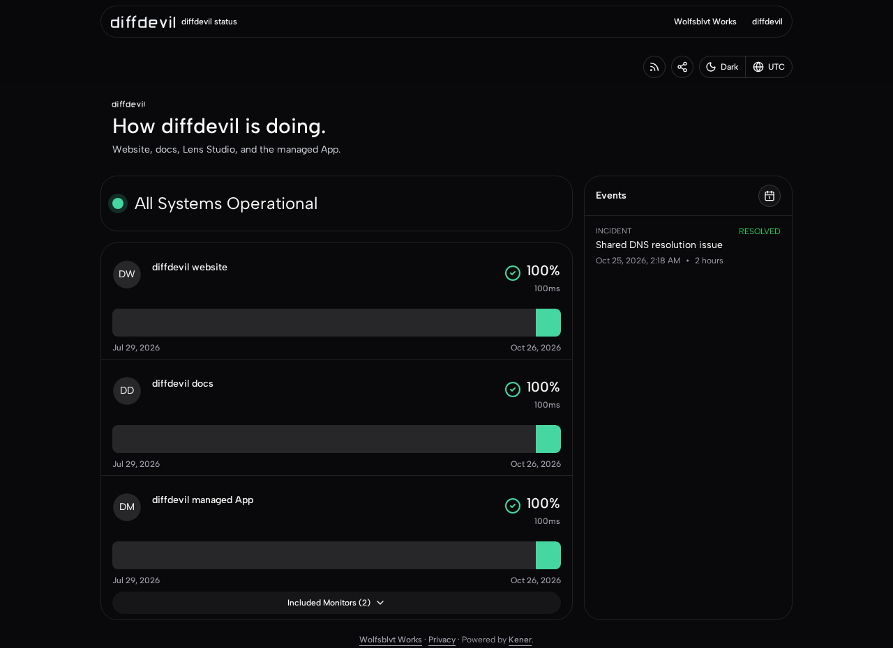
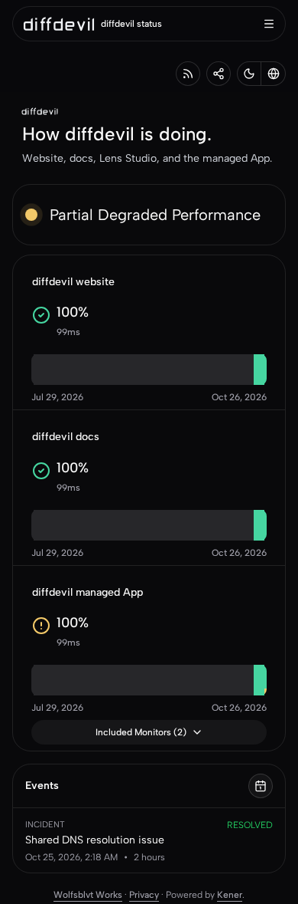
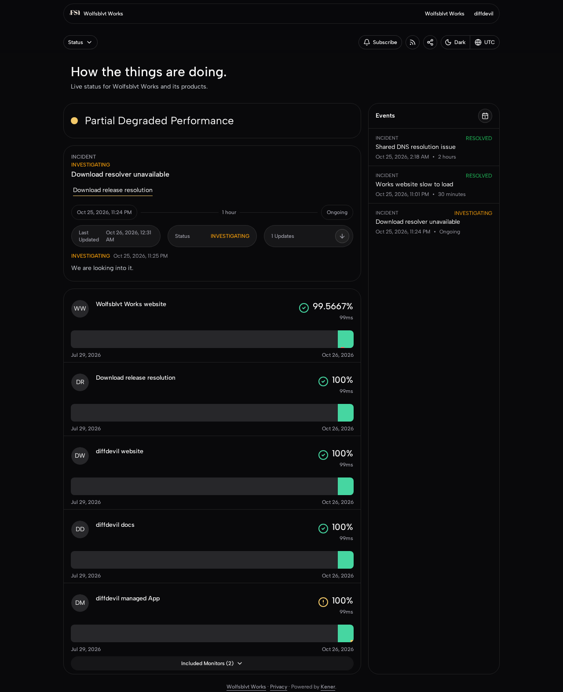
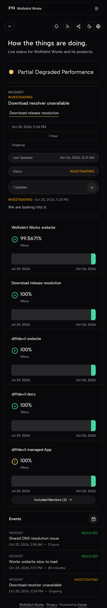
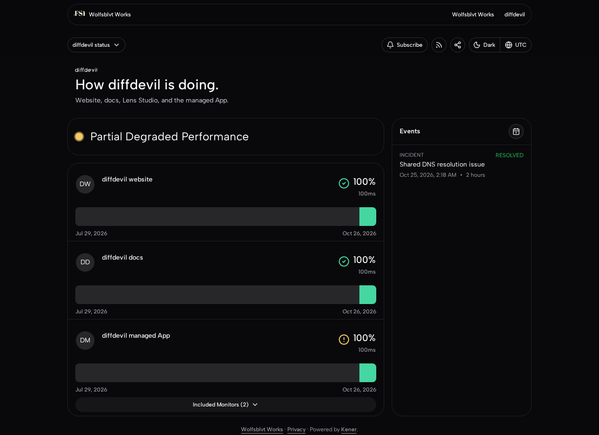
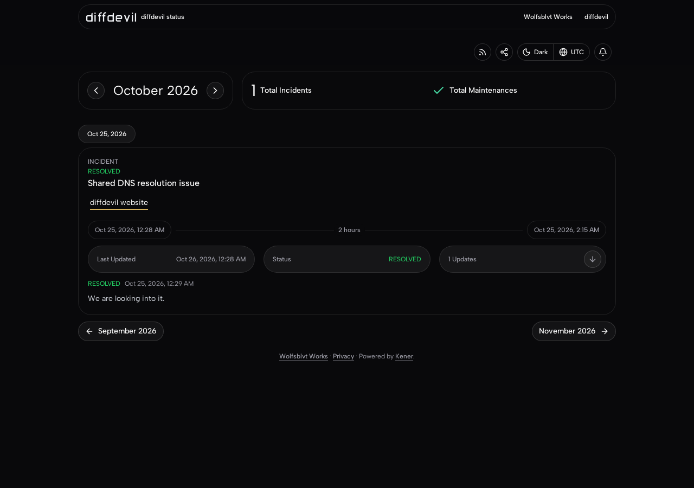
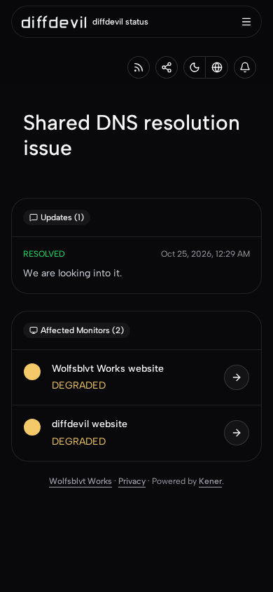

# Admitted public origins: qualification record

## Meaning

This record states what was independently run against the "Admitted public origins" patch at pull-request head
`8e3d79fb7df02c63fe065c735031107b28dcf070` (tree `50c1c3602eba8906e3c66df41ff0636778f7e145`), and what was not. It
adds database-engine and rendered evidence to the SQLite evidence already attached to that head; it changes no source
and settles no product or presentation choice. The patch itself is described in [`../README.md`](../README.md).

## What ran

Everything ran on a Linux x86-64 host against the unchanged head, in an isolated scratch area, with Node 24.22.1 and the
repository's own lockfile.

| Layer | What was used | Note |
| --- | --- | --- |
| SQLite | `better-sqlite3`, in-memory, the repository default | Baseline for the harness below |
| PostgreSQL | 16.14, the upstream-documented major, from the `@embedded-postgres/linux-x64` binary distribution | Not the `postgres:16-alpine` container |
| MariaDB | 11.8.9, the generic Linux binary tarball | Not the `mariadb:11` container; same major line |
| Redis | Valkey 9.1.2, the official Linux binary | A Redis-compatible stand-in for the rendered run only |
| Renderer | `vite dev` serving the head, Chromium headless shell from Playwright 1.61.1 | A development server, not a production build or image |

A small reverse proxy stood in for the front proxy: it forwarded each request with the original `Host` and without the
port, so `KENER_PUBLIC_ORIGINS=https://status.diffdevil.dev=diffdevil` admitted the product host exactly as it would
behind a TLS terminator. Both hostnames were mapped to loopback inside the browser only.

## Database engines

The affected readers and loaders (page, page-monitor, monitor, incident-monitor, maintenance-monitor and site-data
reads, including group membership) were exercised through the repository's own `TEST_DATABASE_URL` route with
`--no-file-parallelism`, as `CODING_STANDARDS.md` describes.

`public-origins.test.ts` and `hidden-monitors.test.ts` build their database as in-memory SQLite and so ignore
`TEST_DATABASE_URL`. They were run through uncommitted copies that differ in two mechanical ways: the database comes
from `CreateTestDb()`, and an inserted row's id is read whether the driver returns `{ id }` or a bare number. On
SQLite the copies behave like the originals (both pass; 153 tests across the five files below).

| Test file | SQLite | PostgreSQL 16.14 | MariaDB 11.8.9 |
| --- | --- | --- | --- |
| `public-origins.test.ts` (copy) | 28/28 | 28/28 | 28/28 |
| `hidden-monitors.test.ts` (copy) | 42/42 | 42/42 | 42/42 |
| `currentStatus.test.ts` (unchanged) | 13/13 | 13/13 | 13/13 |

Event membership, global events, group members and the product/site split behaved the same on all three engines.

One engine difference, which is not part of this patch: on MariaDB the `incidents.incident_type` column has no default
(the migration's `defaultTo("INCIDENT")` on a `text` column is not applied), so a fixture row inserted without that
column reads back `NULL`. The incident controller always sets the type (default `INCIDENT`), but these test fixtures do
not, so on MariaDB 12 of
`hidden-monitors` and 4 of `public-origins` fail until the fixtures set `incident_type: "INCIDENT"`. The same 12 fail on
the base commit `ff606569`, so this predates the patch. The MariaDB figures above include that one added fixture field.

## Rendered, on the real head

A fixture state was built from the repository's own migrations and seeds: the declared public presentation, seven
`NONE`-type monitors (one is a group with two members), a product page that shows the group, a portfolio home page that
shows all of them, and four sample incidents (product-only on a group member, portfolio-only, spanning both, and a
second portfolio-only). Nothing in it is real status data. Pages were captured at 1280 px and 390 px wide.

The captures below use the state with subscriptions enabled and a placeholder email provider, so the portfolio host
shows its Subscribe button and the product host can be seen not to.

| Product Home, desktop | Product Home, narrow |
| --- | --- |
|  |  |

| Portfolio Home, desktop | Portfolio Home, narrow |
| --- | --- |
|  |  |

| The product page on the portfolio host | Product events and an incident |
| --- | --- |
|  |   |

Observed on the product host: the title, nav wordmark, page header, RSS channel title and favicon are the product's; the
favicon is `/brand/diffdevil/assets/icon-favicon/on-dark.svg`. No Subscribe appears, and every subscription action
(`login`, `getPreferences`, `updatePreferences`) answers `400`, while the portfolio host's endpoint stays live. Nothing
overflowed horizontally at 390 px.

| Request | Product host | Portfolio host |
| --- | --- | --- |
| Home canonical | `https://status.diffdevil.dev/` | none (upstream) |
| `/diffdevil` | `308` to `/` | the page, canonical `https://status.diffdevil.dev/` |
| Own monitor, group member, own incident, cross-product incident | `200` | `200` |
| Portfolio-only monitor, incident, monitor feed, badge | `307` to the same path on the site URL | `200` |
| Form `POST` with `Origin` of the other host, or of the product host over `http` | `403` | `403` |
| Form `POST` with the host's own `Origin` | passes CSRF | passes CSRF |
| `robots.txt` | no `kener.ing` sitemap | no `kener.ing` sitemap |

## Findings and limits

1. **An incident on a group member is not listed on the product's Home or events page.** On the product host,
   `/incidents/<id>` answers `200` for an incident whose only monitor is a member of the page's group (and, by the
   patch's rule, subscriber mail would link there), but neither inline events on `/` nor `/events/<month>` list it; the
   portfolio host's events page does. Reproduce: a `GROUP` monitor with members `a` and `b` on the product page, an ongoing incident on
   `a` only, then load `/` and `/events/<current month>` on the product host. The listing code is unchanged by the patch
   (the portfolio host's `/<page>` omits it the same way), so this is an interaction between the patch's "group members
   count as shown" rule and upstream's direct-monitor event listing, not a regression.
2. **`/dashboard-apis/notifications` is not guarded.** On the product host `?tags=<portfolio-only monitor>` answers `200`.
   The patch notes already name the `dashboard-apis` JSON as unguarded; this confirms the exposure for that route.
3. **Presentation left for judgment, as the patch notes say.** The nav shows the wordmark and then the text
   "diffdevil status"; the page header repeats the wordmark; the nav items are the shared site's (the portfolio link and a
   link named "diffdevil"); theme colours and the Works font are shared across hosts. None of this was changed.
4. **Not proven by this record:** a production build or image, a real Redis, TLS or the real front proxy, a deployed
   two-host run, the central compatibility redirect, subscriber mail, real visitor use, and the full test suite.

Fixture state, harness copies and scratch tooling were not committed.
